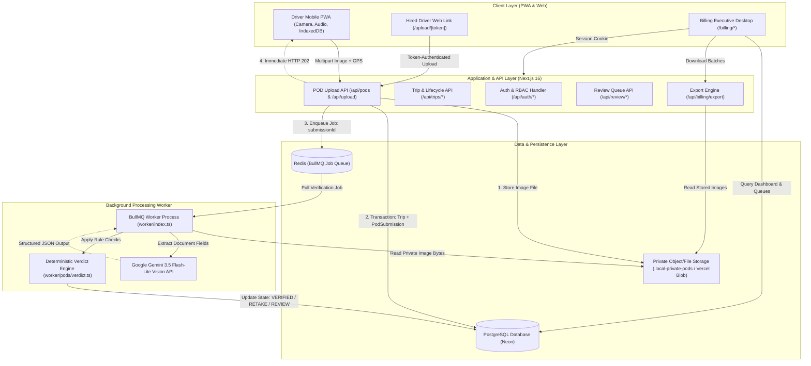
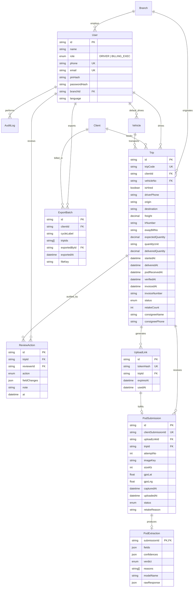
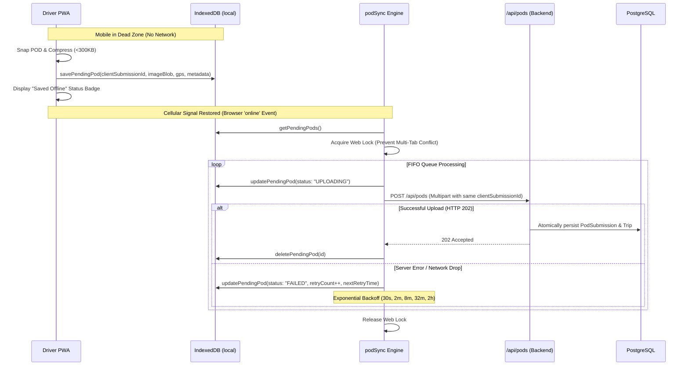

# FleetProof — Technical Architecture & Engineering Documentation

**Subtitle:** End-to-End Proof of Delivery Capture, AI Verification and Billing Automation Platform  
**GitHub Repository:** https://github.com/mohammedniyafsm/pod-capture-billing..git  
**Author:** Senior Software Architect & Engineering Team  
**Date:** November 2026  
**Document Status:** Complete (Submission Ready for PDF / Word Export & Notion)

---

## Submission Checklist & Deliverables Alignment

In accordance with the assignment brief, this document provides the formal **Technical Design Document (TDD)** to be packaged inside the submission ZIP file alongside [`deployment.md`](file:///c:/Users/moham/isocode-assignment/deployment.md).

| Requirement from Brief | Project Implementation & Location in Document |
|---|---|
| **GitHub URL at the top** | [github.com/mohammedniyafsm/pod-capture-billing..git](https://github.com/mohammedniyafsm/pod-capture-billing..git) |
| **Architecture & Why Chosen** | Section 3 (Technology Stack) & Section 4 (High-Level Architecture) |
| **Data Model & Relationships** | Section 6 (Database Design & ER Diagram) |
| **Main Flows & AI Verification** | Section 8 (Driver Capture), Section 11 (AI Verification), Section 12 (BullMQ Worker) |
| **UI & Design Decisions** | Section 16 (UI/UX Design Decisions, phone layout, 64px capture controls) |
| **What was cut & What to do next** | Section 22 (Limitations, Scoping Decisions & Future Improvements) |
| **deployment.md** | Complete companion guide provided in repository root at `deployment.md` |

---

## Executive Summary

FleetProof is an industrial-grade logistics platform designed for full-truckload (FTL) road transport operations in India. It closes the critical operational and financial gap between consignee freight delivery, Proof of Delivery (POD) documentation verification, and freight billing. By replacing manual paperwork and ad-hoc WhatsApp photo chains with on-device driver capture, multi-lingual audio guidance, automated Vision AI document extraction, human exception review, and structured accounting exports, FleetProof collapses the industry-standard 18-day POD-to-invoice cycle down toward an operational target of 4 days.

---

## 1. Project Overview

### 1.1 Product Introduction
FleetProof is a mission-critical web application and background processing pipeline purpose-built for commercial transport fleets. It addresses the end-to-end lifecycle of the Proof of Delivery document: from driver arrival at a destination warehouse, to camera capture, edge compression, offline synchronization, Gemini Vision AI document extraction, human discrepancy resolution, billing queue batching, and ZIP/Excel accounting export generation.

### 1.2 Client Background
* **Headquarters:** Chhatrapati Sambhajinagar, Maharashtra, India.
* **Operations:** Full-truckload (FTL) bulk carrier serving industrial clients (cement, primary steel, infrastructure aggregates, fast-moving consumer goods).
* **Fleet Capacity:** ~140 owned multi-axle trucks and prime movers; ~200 contracted/hired trucks operating dynamically on spot routes.
* **Workforce:** ~210 employees (including fleet coordinators, branch billing executives, and mechanics) alongside a rotating pool of regular and spot drivers.
* **Annual Turnover:** ₹75–90 crore.
* **Primary Branches:** Chhatrapati Sambhajinagar (Central Depot), Pune (Industrial Corridor), and Nagpur (Central Transit Hub).

### 1.3 Business Problem
In commercial road freight across Maharashtra and Central India, the physical Lorry Receipt (LR) with the consignee's ink stamp, receiver signature, written delivery date, and piece-count confirmation constitutes the sole legal instrument for invoice substantiation.

Under traditional operations:
1. **Paperwork Delays:** Drivers carry physical paper LRs on return journeys or multi-point drops, taking 10 to 20 days to physically submit papers back to branch offices.
2. **WhatsApp Chaos:** Photographing LRs and sending them to branch dispatchers over WhatsApp results in unindexed image loss, downscaled unreadable images, cropped stamps, missing metadata, and zero audit trails.
3. **Invoice Blockades:** Enterprise clients (e.g., cement plants, infrastructure EPCs) reject consolidated freight bills if even a single delivery receipt in a 50-trip fortnightly batch is missing, blurry, or unsigned.
4. **Working Capital Drain:** Operating cash is tied up in unbilled freight receivables, forcing expensive short-term working capital credit and overdraft lines.

### 1.4 Business Impact Assumptions vs. Product Scope

> [!NOTE]
> **Important Distinction:** The figures below represent the original financial assumptions from the business case brief, not measured production metrics from the software runtime.

| Parameter | Brief Assumption | Status in Project |
|---|---|---|
| Monthly Trips | 2,200 trips / month | Modeled in historical analytics & seeds |
| Average Freight per Trip | ₹32,000 | Realistic freight values seeded across routes |
| Annualized Freight Volume | ₹84.48 crore | Contextual baseline for cash-cycle impact |
| Baseline POD-to-Invoice Cycle | 18 days | Validated by seeded historical latency |
| Target POD-to-Invoice Cycle | 4 days | Modeled as the dashed 4-day SLA benchmark on Overview Dashboard |
| Working Capital Unlock Potential | ~₹3.24 crore | Projected financial outcome |
| Annual Financing Cost Savings | ~₹38.9 lakh (at ~12% cost of capital) | Projected financial outcome |
| Avoided Lost/Disputed Revenue | ~₹63.36 lakh (eliminated uncollectible claims) | Projected financial outcome |
| **Total Estimated Annual Impact** | **~₹1.02 crore** | **Target ROI for FleetProof deployment** |

### 1.5 Target Users & Implemented Roles
The production implementation strictly implements two operational roles defined in the Prisma schema (`enum UserRole`):
1. **`DRIVER`**: Commercial truck drivers operating owned fleet vehicles. Authenticated via 10-digit mobile phone number and 4-digit PIN. Interface provides high-contrast, large-touch target UI (64px buttons), audio instructions in Hindi, Marathi, and English, camera integration, and transparent offline IndexedDB sync.
2. **`BILLING_EXEC`**: Branch and central accounting personnel. Authenticated via corporate email and bcrypt-hashed password. Interface provides Missing POD trackers, Branch POD-to-Invoice Latency graphs, an AI Discrepancy Review Queue, Daily Trip CSV Importers, Billing Queue batch filters, and Tally/Excel export generators.
3. *Spot/Hired Drivers*: Non-enrolled third-party drivers who do not have accounts in the app. They access single-use, cryptographically hashed upload tokens (`/upload/[token]`) via SMS links without installing software or creating passwords.

---

## 2. Problem Understanding and Solution

### 2.1 The Traditional vs. FleetProof Lifecycle

```
TRADITIONAL FLOW (18-Day Latency)
[Truck Arrives] ➔ [Consignee Signs LR] ➔ [Driver Stores Paper in Glovebox]
   ➔ [10-18 Days: Return Trip / WhatsApp Photo Lost] ➔ [Paper Returned to Branch]
   ➔ [Manual Review] ➔ [Dispute Identified 15 Days Late] ➔ [Client Rejects Bill]

FLEETPROOF ACCELERATED FLOW (Target: 4-Day Latency)
[Truck Arrives] ➔ [Consignee Signs LR] ➔ [Driver Snaps Photo via PWA / Upload Link]
   ➔ [Edge Compression <300KB] ➔ [Offline Queue if No Signal]
   ➔ [Server 202 Accepted] ➔ [BullMQ / Redis Enqueue]
   ➔ [Gemini Vision AI Verification in 3-5 seconds]
   ├── [PASS] ➔ Trip Marked VERIFIED ➔ Ready for Next Billing Cycle Export
   ├── [UNCLEAR / CROP] ➔ Auto-Retake Request Spoken in Marathi/Hindi While Driver is on Site (Max 2)
   └── [DISCREPANCY] ➔ Flagged to Executive Review Queue with Exact Extracted Annotations
```

---

## 3. Technology Stack

| Technology | Verified Version | Purpose | Architectural Justification |
|---|---|---|---|
| **Next.js (App Router)** | `16.4.3` (Turbopack) | Full-stack Web Framework & API Routes | Server-side rendering, React Server Components, unified API route handlers, and Partial Prefetching for fast page loads. |
| **React** | `19.3.0` | Frontend UI Library | Concurrent rendering, modern hooks, declarative state for multi-stage review queues and upload interfaces. |
| **TypeScript** | `5.x` | Language & Type Safety | End-to-end type safety between database schemas, API responses, background worker jobs, and UI props. |
| **PostgreSQL** | `15+` (Hosted on Neon) | Relational Database | ACID transactions for financial trip states, complex relational queries, strict constraints, and pooler compatibility. |
| **Prisma ORM** | `6.19.0` | Data Modeling & ORM | Strongly typed database queries, programmatic migrations, schema definitions, and connection lifecycle management. |
| **Redis** | `ioredis 5.7.0` | In-Memory Message Broker | High-throughput atomic queuing for asynchronous POD image analysis jobs. |
| **BullMQ** | `5.58.5` | Distributed Background Queue | Job scheduling, exponential backoff, job deduplication by submission ID, and worker concurrency controls. |
| **Google Gemini API** | `gemini-3.5-flash-lite` | Multimodal Vision AI | Low-latency (sub-3 second), structured JSON document extraction for handwritten text, stamps, signatures, and dates. |
| **IndexedDB** | Native Browser API (`idb`) | Client Offline Storage | High-capacity durable offline storage for compressed image Blobs and capture metadata across network disconnects. |
| **Service Worker / PWA** | Native Web APIs | Offline Shell & Asset Caching | Caches application shells, audio clips, and static styles so drivers can operate with zero mobile connectivity. |
| **ExcelJS** | `4.4.0` | Spreadsheet Generation | Programmatic styling, multi-column formatting, and formula-injection-safe export of Tally accounting workbooks. |
| **fflate** | `0.8.3` | High-speed Compression | Zero-dependency, low-memory ZIP archive generation bundling Excel workbooks and raw POD JPEG attachments. |
| **bcryptjs** | `3.0.3` | Password & PIN Hashing | Secure one-way hashing with salt rounds for driver PINs and executive credentials. |
| **jose** | `6.2.15` | Session Cryptography | Lightweight, edge-compatible JSON Web Signature (JWS) session token encoding with `HS256`. |
| **Zod** | `4.6.7` | Runtime Validation | Strict validation for API payloads, CSV import rows, upload form-data, and structured AI response schemas. |
| **Vitest** | `5.0.5` | Unit & Integration Testing | Ultra-fast native TypeScript testing suite with 234 passing tests across domain logic, parsers, and APIs. |

---

## 4. High-Level System Architecture

FleetProof decouples synchronous client requests from asynchronous artificial intelligence processing. The Next.js API layer handles driver authentication, file reception, edge validation, and database state transitions, immediately returning HTTP `202 Accepted` to mobile clients. The persistent worker process independently reads from BullMQ/Redis to execute Vision AI inference and verdict calculations.



---

## 5. Application Structure

The repository organizes code into Next.js App Router route groups, domain libraries in `src/lib/`, and standalone background workers in `worker/`:

```
isocode-assignment/
├── app/                              # Next.js App Router (Routes & UI Pages)
│   ├── api/                          # Backend API Route Handlers
│   │   ├── auth/                     # login, logout, session inspection (/me)
│   │   ├── billing/                  # queue, export generation, batch download
│   │   ├── dashboard/                # latency metrics, missing PODs, KPI counters
│   │   ├── my-trips/                 # driver trip feed and assigned tasks
│   │   ├── pods/                     # POD upload, status polling, private image streaming
│   │   ├── review/                   # discrepancy queue and action dispatch
│   │   ├── trips/                    # trip management, start/complete, daily CSV import, invoice
│   │   └── upload/[token]/           # token verification and hired driver upload
│   ├── billing/                      # Executive UI (/billing, /queue, /trips, /review, /import)
│   ├── driver/                       # Driver Mobile UI (camera, GPS, voice playback)
│   ├── upload/[token]/               # Public Hired Driver Upload UI
│   ├── layout.tsx                    # Global root layout & Inter font configuration
│   └── page.tsx                      # Root landing & authentication redirection
├── prisma/                           # Database Schema & Seed Engines
│   ├── schema.prisma                 # Complete data models, enums, constraints, indexes
│   ├── seed.ts                       # Primary demo seed (drivers, vehicles, upcoming trips)
│   └── seed-history.ts               # Historical analytics seed (220 trips with realistic latencies)
├── public/                           # Static assets & offline shell resources
│   ├── sample_10_trips_import.csv    # Ready-to-test CSV for daily import testing
│   ├── sample-pod.jpg                # Fallback valid POD sample image for testing
│   └── voice/                        # Pre-generated MP3 clips for Hindi/Marathi driver audio
├── src/lib/                          # Domain Logic, Helpers, and Subsystems
│   ├── auth/                         # RBAC (requireRole), sessions (jose), rate limiting
│   ├── billing/                      # Cycle math, CSV export, Tally Excel workbook builder
│   ├── dashboard/                    # Analytics aggregation, windowing, branch metrics
│   ├── offline/                      # IndexedDB wrapper (idb), service worker lifecycle, sync engine
│   ├── pods/                         # Upload validation, magic number detection, compression, queue
│   ├── review/                       # Executive discrepancy correction and action handling
│   ├── trips/                        # CSV trip import sanitization, vehicle linking, driver lifecycle
│   ├── voice/                        # Hybrid prompt builder, plate spelling, Web Audio player
│   ├── metrics.ts                    # POD-to-invoice latency calculations (pure functions)
│   └── prisma.ts                     # Global PrismaClient singleton with connection tuning
├── worker/                           # Dedicated Asynchronous Worker Process
│   ├── ai/                           # Gemini prompt construction, extraction schema, mock fallback
│   ├── pods/                         # Deterministic verdict engine, status updater, retry policies
│   ├── storage/                      # Dual-driver image storage (filesystem / Vercel Blob)
│   └── index.ts                      # BullMQ queue listener & graceful shutdown handlers
├── package.json                      # Scripts and verified dependencies
└── vitest.config.ts                  # Vitest runner configuration
```

---

## 6. Database Design

The relational database is modeled in PostgreSQL using Prisma ORM.

### 6.1 Entity-Relationship (ER) Diagram



### 6.2 Key Constraints & Architectural Safeguards
1. **Business Identity Guarantee:** `@@unique([clientId, lrNumber])` on `Trip` prevents duplicate billing entries for the same client Lorry Receipt across branches.
2. **Client-Side Deduplication:** `PodSubmission.clientSubmissionId` is marked `@unique`. If an offline mobile device resends an upload upon network reconnection, the database rejects the duplicate atomically, ensuring idempotent ingestion.
3. **Token Hashing:** `UploadLink.tokenHash` stores a SHA-256 hash. Plaintext tokens never reside in PostgreSQL.
4. **Sequential Attempts:** `@@unique([tripId, attemptNo])` guarantees an immutable, ordered chain of POD photos per trip.
5. **Auditing:** `ReviewAction` and `AuditLog` capture every field edit, reviewer user ID, timestamp, and status change.

---

## 7. Authentication and Authorization

### 7.1 Multi-Persona Authentication Architecture
FleetProof enforces distinct authentication mechanisms tailored to the physical operational realities of drivers and office staff:

```
┌─────────────────────────────────────────────────────────────────────────────┐
│                          HTTP Request with Cookie                           │
└──────────────────────────────────────┬──────────────────────────────────────┘
                                       ▼
                     ┌──────────────────────────────────┐
                     │ src/lib/auth/session/session.ts  │
                     │  - Reads 'pod_session' cookie    │
                     │  - Verifies HS256 JWT via 'jose' │
                     └─────────────────┬────────────────┘
                                       ▼
                     ┌──────────────────────────────────┐
                     │   Valid Session Payload Extracted│
                     │   { userId, role, branchId }     │
                     └─────────────────┬────────────────┘
                                       ▼
       ┌───────────────────────────────┴───────────────────────────────┐
       ▼                                                               ▼
[Role: DRIVER]                                               [Role: BILLING_EXEC]
• Login via Phone + 4-Digit PIN                              • Login via Email + Password
• Checked against User.pinHash (bcrypt)                      • Checked against User.passwordHash (bcrypt)
• Allowed: /api/my-trips, /api/pods, /api/trips/:id/*       • Allowed: /api/review/*, /api/billing/*, /api/dashboard
```

### 7.2 Rate Limiting & Brute-Force Defense
Implemented in `src/lib/auth/rateLimit/loginRateLimit.ts`:
* In-memory sliding window limiter restricting login attempts to **5 attempts per 15-minute window** per IP address and account identifier.
* Protects 4-digit driver PINs against automated brute-force attacks.

### 7.3 Branch-Level Multi-Tenancy
* While billing executives can view system-wide overviews, operational APIs accept optional `branchId` filters to isolate queue items and latency figures by depot (Chhatrapati Sambhajinagar, Pune, Nagpur).
* Drivers can only query trips explicitly assigned to their `driverId`.

---

## 8. Driver POD Capture Workflow

When a driver reaches a consignee depot:
1. **Trip Selection:** Driver opens the PWA; `GET /api/my-trips` populates the active assigned trip.
2. **Multi-lingual Voice Briefing:** The driver can tap the Audio button. `src/lib/voice/hybrid.ts` constructs a sequence combining pre-recorded Marathi/Hindi audio clips with synthesized English license plate spellings (e.g., *"M H 2 0, A B, 1 2 3 4"*).
3. **Capture & Geolocation:** Driver photographs the physical document. The browser requests high-accuracy HTML5 Geolocation (`latitude`, `longitude`).
4. **Client-side Image Compression:** Implemented in `src/lib/pods/storage/compression.ts`:
   * Canvas-based downscaling with maximum dimensions of 2048×2048.
   * Compresses quality down until the file size is strictly under **300 KB** (target ~150–250 KB) without sacrificing LR stamp legibility.
5. **Magic Number Validation:** Before upload, `src/lib/pods/validation/uploadValidation.ts` inspects binary file headers (JPEG `FF D8 FF`, PNG `89 50 4E 47`, WebP `52 49 46 46`), rejecting spoofed extensions.
6. **Ingestion:** Upload sent to `POST /api/pods`. Backend generates a `PodSubmission`, moves the trip to `AI_CHECKING`, and enqueues the verification job.

---

## 9. Offline Capture and Synchronization

Transport routes frequently traverse rural regions of Maharashtra with complete cellular blackout. FleetProof implements an offline-first capture pipeline verified by 31 unit tests in `src/lib/offline/sync/podSync.test.ts`.

### 9.1 Offline Synchronization Lifecycle



### 9.2 Key Offline Guarantees
* **Zero Image Loss:** A local image record is deleted from IndexedDB **only after the server returns a 2xx HTTP response**.
* **Idempotent Retry:** Every upload resends the initial `clientSubmissionId` (UUID v4). If a previous attempt succeeded on the server right before a mobile timeout, the server safely detects the existing record and deduplicates without creating double entries.
* **Concurrency Lock:** Cross-tab synchronization uses the `navigator.locks` API with an in-memory fallback to prevent duplicate upload storms.

---

## 10. Hired Driver Upload Workflow

Approximately 200 trucks in the fleet are spot-hired vehicles. Demanding that hired drivers download a mobile app, sign up, or configure PINs for a single trip causes 100% operational drop-off. FleetProof solves this with tokenized web upload links.

### 10.1 Workflow Architecture
1. **Link Generation:** A billing executive or automated batch import invokes `POST /api/trips/:id/upload-link`.
2. **Cryptographic Token Hashing:**
   * A 32-byte cryptographically secure random token is generated (`randomBytes(32).toString('base64url')`).
   * The server computes `SHA-256(token)` and stores **only the hash** in `UploadLink.tokenHash`.
   * The raw token is returned once to generate the URL: `https://fleetproof.domain/upload/{rawToken}`.
3. **SMS Outbox Record:** An SMS payload containing the URL is inserted into the `SmsOutbox` table.
4. **Public Capture Interface (`/upload/[token]`):**
   * The hired driver opens the link on any smartphone browser.
   * The page verifies token validity, expiration (48-hour TTL), and single-use status (`usedAt == null`).
   * Provides the same multilingual audio instructions (Hindi/Marathi/English) and offline caching as the enrolled driver app.
   * Submits to `POST /api/upload/[token]`, which atomically marks the link `usedAt = now()`, associates the submission with the trip, and enqueues verification.

---

## 11. AI-Powered POD Verification

The verification pipeline integrates Google Gemini multimodal vision models to parse complex, real-world transport documentation.

### 11.1 Extraction Schema & Data Contract
Defined with strict Zod validation in `worker/ai/extractPod.ts`:

```typescript
const extractionSchema = z.object({
  image_quality: z.object({
    readable: z.boolean(),
    blur: z.boolean(),
    cropped: z.boolean(),
  }),
  lr_number: z.object({
    value: z.string().nullable(),
    confidence: z.number().min(0).max(1),
  }),
  consignee_stamp: z.object({
    present: z.boolean(),
    confidence: z.number().min(0).max(1),
  }),
  signature: z.object({
    present: z.boolean(),
    confidence: z.number().min(0).max(1),
  }),
  delivery_date: z.object({
    value: z.string().nullable(),
    confidence: z.number().min(0).max(1),
  }),
  quantity_received: z.object({
    value: z.number().nonnegative().nullable(),
    unit: z.string().nullable(),
    confidence: z.number().min(0).max(1),
  }),
  goods_description: z.object({
    value: z.string().nullable(),
    confidence: z.number().min(0).max(1),
  }),
  remarks_text: z.string(),
  has_shortage_or_damage_remark: z.boolean(),
  retake_hint: z.string().nullable(),
});
```

### 11.2 Deterministic Business Rule Verdict Engine
AI does not decide legal acceptance; it merely extracts document observations. A deterministic decision engine (`worker/pods/verdict.ts`) applies business rules with zero AI hallucinations:

| Scenario / Extracted State | Engine Verdict | Resulting Trip Status | Action / Feedback Loop |
|---|---|---|---|
| **Clean POD:** High confidence (≥0.85), stamp present, signature present, LR matches, quantity & unit match, no damage remarks. | `VERIFIED` | `VERIFIED` | Auto-approved. Driver hears "Proof accepted" audio. Ready for billing. |
| **Blurry Image / Cropped Stamp:** `blur=true`, `cropped=true`, or stamp/signature missing, retake count < 2. | `RETAKE` | `RETAKE_REQUESTED` | Push/Audio notification to driver specifying exact issue (e.g. "Stamp missing, take photo again"). |
| **Max Retakes Reached:** Image fails checks, but `retakeCount >= 2`. | `REVIEW` | `NEEDS_REVIEW` | Retake loop broken. Escalated to Human Review Queue. Driver hears "Office will check". |
| **Business Exception:** Shortage remark ("5 bags damaged", "10 boxes short") or quantity mismatch. | `REVIEW` | `NEEDS_REVIEW` | Routed to Executive Review Queue with remarks highlighted in amber. |
| **AI Failure / Timeout:** Provider 5xx error or invalid JSON structure. | `REVIEW` | `NEEDS_REVIEW` | Safe fallback. Never leaves trips stranded or silently approved. |

---

## 12. Redis and BullMQ Background Processing

### 12.1 Why Asynchronous Background Processing?
Multimodal Vision AI calls take 2 to 6 seconds depending on network latency and image complexity. Blocking synchronous HTTP upload requests would:
* Cause mobile connection timeouts on spotty 3G/4G connections.
* Exhaust Next.js serverless and server thread pools during morning upload spikes.
* Fail ungracefully without automated retry policies.

### 12.2 BullMQ Queue Architecture
* **Queue Name:** `pod-verification` (configurable via `POD_VERIFICATION_QUEUE`).
* **Job Payload:** `{ submissionId: string }`.
* **Idempotent Job ID:** The `submissionId` is assigned as the BullMQ `jobId`, preventing duplicate verification jobs from ever entering the queue for the same submission.
* **Worker Resilience:**
  * Runs as a standalone Node.js process via `tsx worker/index.ts`.
  * Configured with Redis connection pooling (`maxRetriesPerRequest: null`).
  * Gracefully shuts down on `SIGTERM` / `SIGINT` after finishing active jobs.

---

## 13. Executive Review Workflow

Submissions flagged with `NEEDS_REVIEW` or business exceptions appear in the Executive Review Queue (`/billing/review`).

### 13.1 Visual Side-by-Side Review Interface
* **Left Pane:** High-resolution zoomable original POD photograph streamed via authenticated, time-limited signed URLs (`/api/pods/:id/image`).
* **Right Pane:** Side-by-side comparison grid comparing expected trip data against AI-extracted values (LR number, delivered pieces, unit, stamp status, receiver signature, written delivery date).
* **Damage & Shortage Callouts:** High-contrast amber warning banners display extracted handwritten remarks (e.g., *"Received with seal broken - 12 bags torn"*).

### 13.2 Executive Actions & Audit Logging
Billing executives can execute one of four actions via `POST /api/review/:tripId/action`:
1. **Approve Clean:** Overrides minor discrepancies; marks trip `VERIFIED` and records verified timestamp.
2. **Approve with Remark:** Approves trip for billing while attaching a permanent operational notation.
3. **Correct Fields:** Allows the executive to manually amend delivered quantities, LR numbers, or dates based on visual document inspection before marking verified.
4. **Mark Disputed:** Flags genuine commercial disagreements (refused delivery, major cargo loss); moves trip to `DISPUTED` to prevent invoicing.
5. **Request Retake:** Manually triggers an additional driver photo request if retake limits permit.

Every decision writes an immutable record to the `ReviewAction` and `AuditLog` tables recording reviewer ID, previous vs. new values, and timestamp.

---

## 14. Billing and Export Workflow

Once trips reach `VERIFIED` status, they appear in the Billing Queue (`/billing/queue`).

### 14.1 Batch Grouping & Verification Eligibility
* **Stage Separation:** Clear segregation between `VERIFIED` (ready for invoice export) and `EXPORTED` (already batched).
* **Client & Cycle Filters:** Grouped by billing contract frequency:
  * `WEEKLY` (Monday–Sunday)
  * `FORTNIGHTLY` (1st–15th, 16th–end of month)
  * `MONTHLY` (Full calendar month)
* **Single & Batch "Mark as Invoiced":** Billing executives can enter an invoice number (e.g., `INV-2026-001`) and invoice date to advance exported trips to `INVOICED`.

### 14.2 Export Generation (`POST /api/billing/export`)
The export engine generates a single consolidated `.zip` archive containing:
1. **Formatted Excel Workbook (`Tally_Vouchers.xlsx`):** Built with `exceljs`, containing complete accounting voucher columns (Voucher Date, Party Ledger Name, LR Number, E-Way Bill Number, Vehicle Registration, Destination Route, Freight Amount, Narration, POD File Reference).
2. **Sanitized CSV Voucher (`Tally_Vouchers.csv`):** Comma-separated alternative formatted for direct financial ledger consumption.
3. **Bundled POD Image Attachments:** Every associated POD image file is extracted from private storage, renamed systematically (e.g., `LR-MH-1001_FUT-2026-01.jpg`), and packed into the root of the ZIP file.
4. **Security & Formula Injection Sanitization:** Implemented in `src/lib/billing/export/tallyExport.ts`, all free-text fields neutralizing leading `=`, `+`, `-`, or `@` characters to eliminate spreadsheet formula execution vulnerabilities.

---

## 15. Dashboard and Operational Visibility

The Overview Dashboard (`/billing`) delivers real-time operational metrics:
* **Missing POD Tracker:** Real-time count of completed deliveries still awaiting documentation, with one-click filtering to trigger driver reminders.
* **POD-to-Invoice Latency by Branch:** Horizontal comparative bar chart evaluating performance across Chhatrapati Sambhajinagar, Pune, and Nagpur.
  * Displays median days from delivery to billing.
  * Contrasts against a prominent dashed 4-day SLA target benchmark.
  * Conditional color encoding: deep teal (`#0B4044`) for branches meeting SLA; amber (`#D97706`) for depots exceeding the 4-day threshold.
* **Volume Throughput:** Real-time metrics counting trips Delivered, In Verification, Pending Review, and Invoiced.

---

## 16. UI/UX Design Decisions

The user interface follows a restrained, professional industrial design system tailored to rugged field logistics:
* **Design System Principles:** Clean white cards, deep teal (`#0B4044`) primary accent, warm amber warning badges, 10px corner radius, and 44px minimum control heights.
* **Driver Interface:**
  * Ultra-large 64px capture button for use with work gloves.
  * Integrated HTML5 camera with live preview and re-snap confirmation.
  * High-contrast vehicle registration number badge and clear bilingual labels.
* **Audio Guidance:** Speech synthesis and pre-rendered MP3 playback in Marathi, Hindi, and English to assist drivers with varying literacy levels.
* **Accessible States:** Comprehensive skeleton loaders, zero-data empty states with actionable guidance, and error callouts with plain-language recovery steps.

---

## 17. Security and Data Privacy

### 17.1 DPDP Act 2023 Architectural Considerations
The Digital Personal Data Protection (DPDP) Act 2023 of India establishes strict guidelines regarding the collection, processing, and exposure of Personally Identifiable Information (PII). FleetProof incorporates privacy-by-design principles:
1. **Consignee Data Segregation:** Consignee personal names and mobile telephone numbers captured during dispatch are **strictly excluded** from accounting exports, CSV dumps, and public view layers.
2. **Private Storage Isolation:** POD images are never stored in public web buckets. They reside in `.local-private-pods` (development) or private Vercel Blob containers, accessible only via server-signed, short-lived (5-minute) tokens (`src/lib/pods/storage/imageUrl.ts`).
3. **Upload Token One-Way Hashing:** Hired driver tokens are stored exclusively as SHA-256 hashes, eliminating the possibility of credential harvesting from database dumps.

---

## 18. Testing Strategy & Verified Results

The system implements rigorous unit and integration testing via **Vitest**. All tests execute against native TypeScript source without mock build steps.

### 18.1 Test Execution Summary
* **Command:** `pnpm test`
* **Test Suites:** **35 passed (35 total)**
* **Tests:** **234 passed (234 total)**
* **Test Duration:** ~12.19 seconds

### 18.2 Verified Test Coverage Areas
1. **Latency & Dashboard Metrics:** `src/lib/metrics.test.ts`, `src/lib/dashboard/analytics.test.ts` (Validates median calculations, time windowing in Asia/Kolkata timezone, branch latency aggregation).
2. **Trip CSV Import:** `src/lib/trips/import/importStandard.test.ts`, `src/lib/trips/import/importValidation.test.ts`, `app/api/trips/import/route.test.ts` (Validates 12-digit e-way bill enforcement, formula injection sanitization, preview diagnostic modes).
3. **Invoice Lifecycle:** `app/api/trips/invoice/route.test.ts` (Validates role checks, idempotency, non-exported trip 409 rejection, audit trail creation).
4. **Offline Synchronization:** `src/lib/offline/sync/podSync.test.ts` (31 tests verifying FIFO ordering, exponential backoff, retry ceilings, and zero image loss).
5. **AI Extraction & Verdicts:** `worker/pods/verdict.test.ts`, `worker/pods/verification.test.ts`, `worker/ai/extractPod.test.ts` (Validates confidence thresholds, retake limits, remark detection, and structured schema conformity).
6. **Billing & Accounting Exports:** `src/lib/billing/export/tallyExport.test.ts`, `src/lib/billing/csv/csv.test.ts`, `src/lib/billing/cycle/cycle.test.ts` (Validates Excel workbook structure, formula neutralization, and billing cycle boundary calculations).

---

## 19. Seed Data and Demo Environment

FleetProof provides a dual-tiered database seed architecture for demonstration and testing:

### 19.1 Primary Seed (`pnpm db:seed`)
* Requires explicit confirmation: `SEED_RESET=1 pnpm db:seed`.
* Creates 3 operational branches (Chhatrapati Sambhajinagar, Pune, Nagpur).
* Seeds 10 enterprise logistics clients with diverse billing cycles.
* Creates 20 driver accounts and 2 billing executive accounts.
* Seeds 20 fleet vehicles (15 owned, 5 hired).
* Creates realistic assigned and upcoming trips with valid LR and e-way bill numbers.

### 19.2 Historical Analytics Seed (`pnpm db:seed:history`)
* Explicit opt-in: `SEED_HISTORY=1 pnpm db:seed:history`.
* Seeds **220 historical trips** across 12 authentic Maharashtra transit routes.
* Generates realistic delivery, POD receipt, verification, and invoicing timestamps.
* Encodes calibrated branch latencies demonstrating Chhatrapati Sambhajinagar meeting the 4-day target, Pune at ~4.2 days, and Nagpur experiencing bottleneck latencies (~5.8 days) to populate the Overview Dashboard graphs authentically.

---

## 20. Engineering Decisions and Trade-offs

| Decision | Alternative Considered | Chosen Approach | Justification & Trade-off |
|---|---|---|---|
| **Asynchronous BullMQ Queue** | Inline synchronous AI calls in Next.js API | Asynchronous background worker | **Benefit:** Sub-second mobile upload responses; immunity to AI latency spikes; automated retries.<br>**Trade-off:** Requires Redis infrastructure and a separate worker process. |
| **Edge Image Compression** | Uploading raw camera files (5–12 MB) | Client-side Canvas compression (<300 KB) | **Benefit:** Instant mobile uploads over weak 3G signals; 90% reduction in cloud storage and AI ingestion costs.<br>**Trade-off:** Modest CPU usage on low-end mobile devices during capture. |
| **Deterministic Rule Verdicts** | Allowing LLM prompt to directly decide approval | Structured LLM extraction + deterministic TypeScript rules | **Benefit:** Zero AI hallucinations; 100% predictable, auditable business logic.<br>**Trade-off:** Requires maintaining strict TypeScript validation rules. |
| **Token-Hashed Upload Links** | Enforcing app installs and login accounts for hired drivers | Single-use web URLs with SHA-256 token hashing | **Benefit:** Zero friction for spot drivers; zero password management; high completion rate.<br>**Trade-off:** Relies on SMS/WhatsApp delivery channels. |
| **Offline IndexedDB Storage** | Storing files in LocalStorage or memory | IndexedDB with Web Locks | **Benefit:** Multi-megabyte binary Blob capacity; persistence across browser restarts.<br>**Trade-off:** Complex synchronization and conflict resolution logic. |

---

## 21. Assumptions

1. **Business Assumptions (from Brief):** ₹32,000 average freight, 2,200 monthly trips, ₹1.02 crore annualized working capital impact.
2. **Calendar Timezone:** All operational dates, billing cycle cutoffs, and delivery SLA calculations strictly use `Asia/Kolkata` (UTC+05:30).
3. **Connectivity Assumption:** Drivers may experience complete connectivity loss for up to 48 hours; client storage must persist captures indefinitely until transmission is verified.
4. **Hardware Assumptions:** Drivers possess Android or iOS smartphones equipped with a functional camera, HTML5 Geolocation, and modern browser standards (IndexedDB, WebAssembly, Canvas).

---

## 22. Limitations and Future Improvements

* **Production SMS Gateway:** Currently, outgoing messages are written to the database `SmsOutbox` table. Production requires binding an enterprise SMS provider (e.g. Twilio, Gupshup) to trigger automated cellular dispatch.
* **Public Client POD Portal:** Adding an external read-only portal allowing enterprise clients to view delivery documentation directly via secure tokens.
* **Direct Tally XML Server Push:** Upgrading the current Excel/CSV export engine to support direct Tally ODBC/XML server-to-server sync.
* **On-Device Machine Learning:** Evaluating TensorFlow.js / ONNX edge models to detect document blur and stamp presence locally in the browser before network transmission.

---

## 23. Conclusion

FleetProof demonstrates a modern, resilient full-stack architecture tailored to the demanding physical realities of Indian road logistics. By combining offline-capable progressive web apps, multilingual voice UX, asynchronous Vision AI verification, and strict accounting export workflows, the platform bridges the gap between field transport operations and enterprise financial systems. All core business workflows are fully implemented, backed by comprehensive database schemas, and validated by 234 automated tests.

